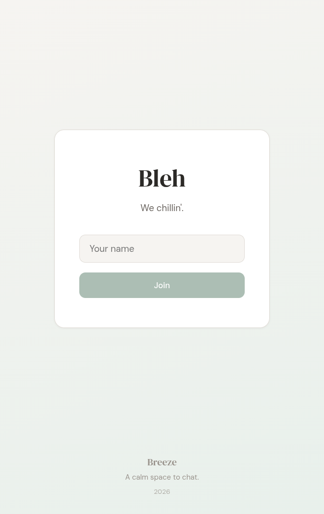
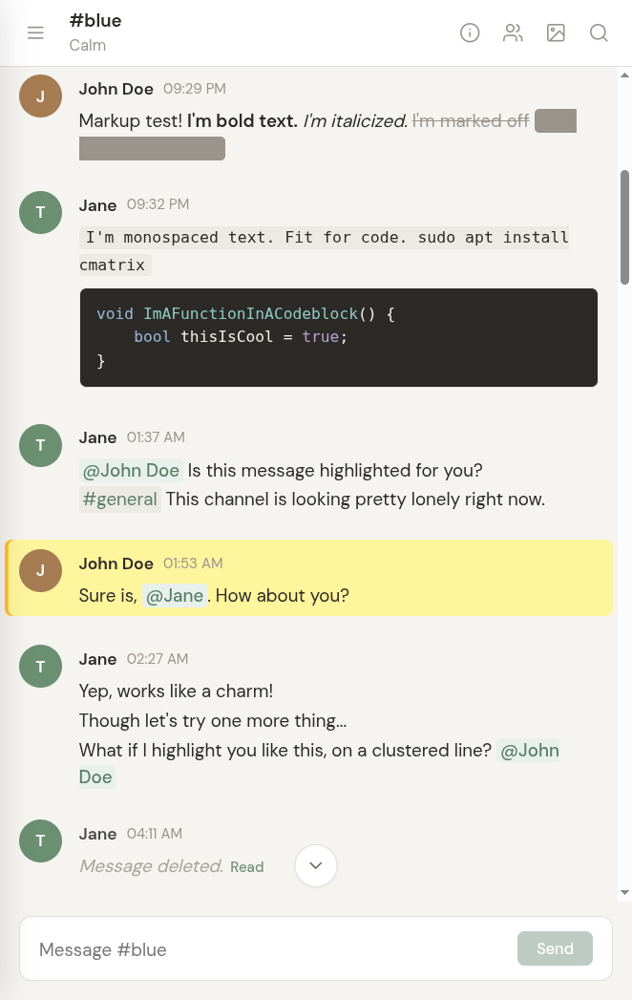
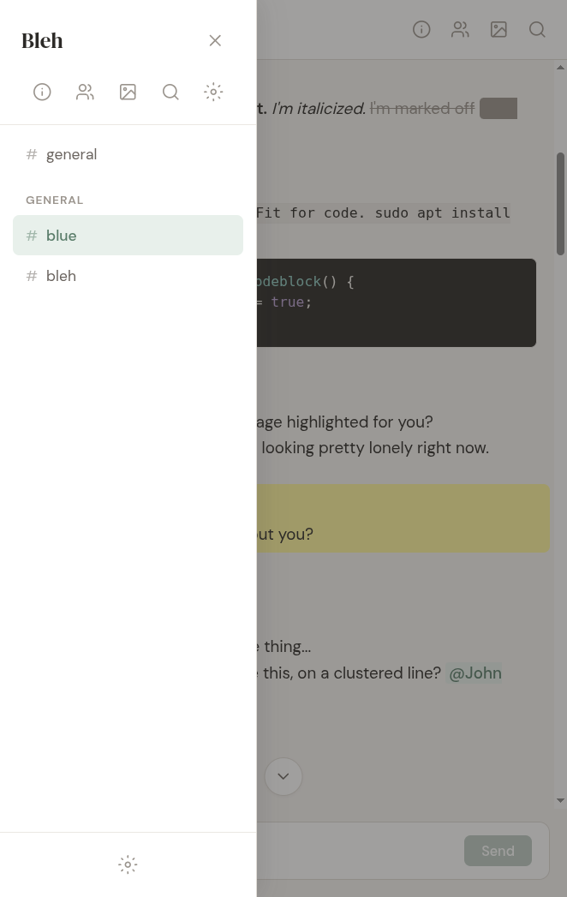
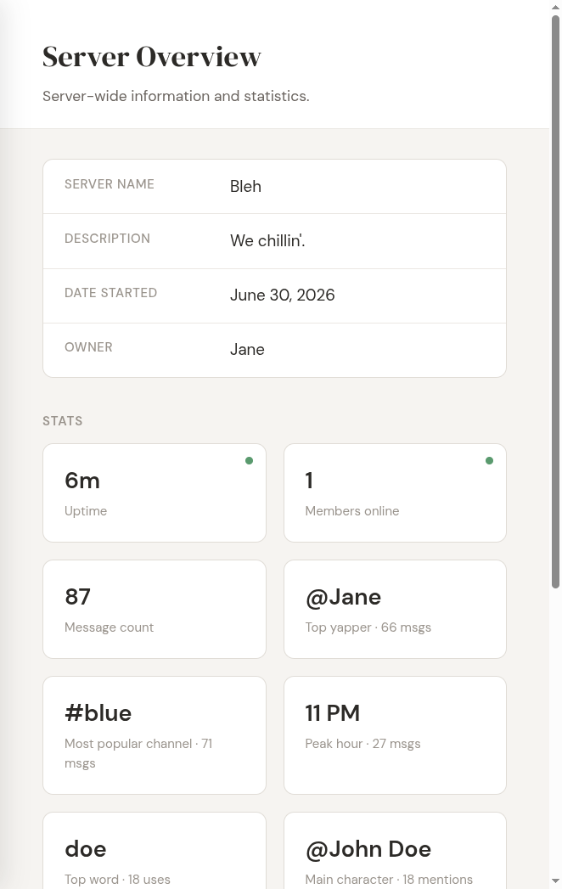

**Note.** The code in this project was generated automatically to match my design, and I tested it from the user side.

# Breeze

A calm, self-hosted chat. Discord for the room layout, IRC for the feel: channels, a topic line, text first, and tools only when you ask for them.

<p>
  
  
  
  
</p>

One Node.js process serves the API and the client in production. Messages go over WebSockets and land in SQLite, so there is no database to set up. Shared links get an Open Graph preview. Image and video URLs render in the message.

The first visit creates the server admin. Later visits can join with a username, or sign in with a password. An admin can close login to everyone else.

## Run

Linux, macOS, or WSL:

```bash
./scripts/start-dev.sh
```

Windows:

```bat
scripts\start-dev.bat
```

The script installs dependencies when they are missing, and rebuilds `better-sqlite3` when this folder was last set up on the other operating system. Then it starts the API and the client together.

Open http://localhost:5173. The API listens on port 3001.

To install and start by hand:

```bash
npm install
npm install --prefix server
npm install --prefix client
npm run dev
```

## Production

```bash
npm run build
npm start
```

Set `PORT` to change the server port. The default is 3001.

## What is in place

- Channels grouped by category, with a topic line.
- Real-time messages, typing, and presence.
- Markup, mentions, inline media, and link previews.
- Unread state, message links, and search.
- Admin settings, access on a channel or a category, and moderation.

## To do

- [ ] Attachments.
- [ ] More autocomplete, markup, and `/` commands.
- [ ] More page styling.
- [ ] A choice of an anonymous nickname, or an account with a password and a profile.
- [ ] Voice chat, camera, and desktop streaming.
- [ ] Automatic moderation tools.
- [ ] Roles.
- [ ] Friends and direct messages.

Requires Node.js 20 or newer.
